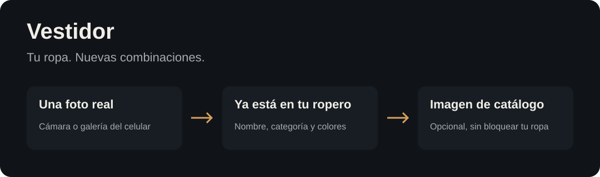

# Vestidor



## Toda tu ropa, en un lugar. Más ideas para usarla.

Ese pantalón que siempre combinás igual. La remera que te olvidás que tenés. Las fotos de outfits que quedan perdidas en la galería. **Vestidor los junta en tu propio ropero digital.**

Sacá una foto desde el celular, poné nombre, categoría y colores, y guardá. No necesitás recortar nada ni pagar una API de IA para empezar.

[Empezar con mi agente](#decile-a-tu-agente-quiero-usar-vestidor) · [Instalar yo](#arrancar-en-local) · [Publicar en privado](docs/deployment.md) · [Cómo funciona](docs/agent-guide.md)

### La experiencia

- **Tu ropa real.** Cámara o galería; la foto ya sirve como imagen de la prenda.
- **Encontrala de un vistazo.** Categorías, búsqueda, muestras de color y ejemplos visuales de cada estilo tomados de tu propio ropero.
- **Confirmá antes de sumar.** Editá propuestas, vinculá prendas repetidas y separá fotos que no son de la misma pieza.
- **Volvé a tus outfits.** Dos colecciones tipo Pinterest: **Generados por tu agente** y **Que usaste**, con imágenes sin recortar y prendas vinculadas. Borrá lo que no querés; la papelera permite recuperarlo.
- **Mejorá las imágenes después.** Una prenda confirmada puede esperar su imagen IA sin desaparecer del inventario. Frente, espalda y foto original se conservan separados.
- **Tu instancia es privada.** Login, fotos protegidas y datos fuera del código público. Un dueño por instalación; no es una red social.

### Decile a tu agente: «quiero usar Vestidor»

Cloná el repositorio y abrilo con tu agente:

```sh
git clone https://github.com/MatiasJRB/vestidor.git
cd vestidor
```

> Quiero usar Vestidor. Leé AGENTS.md, prepará la instalación privada sin contratar nada y ayudame a cargar mi primera prenda.

[AGENTS.md](AGENTS.md) le da un recorrido verificable: instalar, preparar acceso, comprobar el entorno, abrir la app y acompañar tu primera carga. Después puede ayudarte a clasificar y proponer outfits usando **lo que realmente tenés**. El agente es el tuyo (Codex, Claude Code, etc.), no un chat IA incluido ni un servicio gratuito de generación ilimitada.

### Arrancar en local

Node.js **22.18+**:

```sh
npm ci
npm run setup
npm run doctor
npm run dev
```

Abrí `http://127.0.0.1:4180`. Setup muestra una contraseña inicial y guarda sólo su hash en `.env.local`; si ya existe configuración, no la pisa. Los datos arrancan vacíos en `data/`. No se incluyen fotos ni credenciales del creador.

**Desde el celular:** un `127.0.0.1` de tu computadora no es accesible desde el teléfono. Para usarlo desde cualquier lugar publicá tu propia instancia HTTPS con login; [guía de despliegue](docs/deployment.md).

### ¿Y la IA? ¿Y Google Fotos?

La carga, los filtros y el inventario **no requieren IA**. Generar imágenes es opcional y necesita una herramienta de tu agente, un modelo local o una API (con sus propios costos). Marcar «pendiente» no enciende un servicio automático ni genera cobros.

Google Photos Picker funciona en la instalación local con tu credencial y selección explícita. El despliegue Vercel no importa Google Fotos directamente ni sincroniza cambios automáticamente. El login Google sólo verifica tu identidad. [Flujos y límites reales](docs/agent-guide.md).

### Para quienes construyen

React · TypeScript · Vite · Node.js. Backend local persistente o Vercel Functions + Blob **privado**. Licencia MIT. `npm test` y `npm run build` antes de enviar cambios.

## Datos y respaldo

```text
data/
  private/   # inventory.json, outfits.json, suggestions.json, review-queue.json,
             # catalog-generation-queue.json, photos/, imports/
  public/    # items/ y outfits/: nombres internos, NO acceso público por HTTP
```

Todo el contenido de datos requiere login, incluidos `/items`, `/outfits` y `/media`. En la edición cloud, el HTML y JS/CSS genéricos son públicos, pero no contienen datos personales; las APIs y las fotos verifican la sesión en el servidor.

Respaldá **todo `DATA_DIR`**, no sólo el código. La edición usa archivos JSON con escrituras atómicas y serializa las decisiones de revisión: desplegá **una sola réplica**. No uses un filesystem efímero ni dos procesos escribiendo el mismo ropero.

## Publicar tu instancia

Construí con `npm run build` y ejecutá `npm start` detrás de HTTPS. Variables:

- `ADMIN_PASSWORD_HASH`: hash scrypt obtenido con el script.
- `DATA_DIR`: directorio persistente (por ejemplo `/data`).
- `PUBLIC_ORIGIN`: origen HTTPS exacto, sin `/` final.
- `PORT`: puerto HTTP interno (por defecto 4180).

El `Dockerfile` y `railway.json` permiten desplegar en un servicio Node con volumen en `/data`; no requieren Docker en tu computadora. Nunca publiques `data/`, `.env.local`, tokens OAuth ni respaldos. El dominio HTTPS no vuelve privado un archivo: el servidor aplica autenticación también a las imágenes.

Para una migración inicial controlada, `ALLOW_DATA_IMPORT=true` habilita `POST /api/admin/import-file` sólo a sesiones autenticadas y same-origin. Acepta rutas limitadas en `X-File-Path` y hasta 12 MiB por archivo. Deshabilitalo al terminar. Nunca debe recibir archivos de terceros. `docs/deployment.md` detalla los límites.

## Edición gratuita en Vercel

El despliegue cloud usa **Vercel Hobby + un Blob store privado**. No necesita InsForge, Railway ni un servidor permanente. Los planes gratuitos tienen cupos y pueden suspender operaciones al superarlos; no se promete disponibilidad ilimitada ni generación IA gratuita.

1. Creá tu proyecto en Vercel Hobby y un Blob store con **access: private** (no public).
2. Vinculá el store al proyecto y guardá BLOB_READ_WRITE_TOKEN sólo en variables de servidor.
3. Creá un cliente OAuth Web en Google Cloud, con origen de tu app y redirect exacto `https://tu-app.vercel.app/auth/google/callback`.
4. Configurá AUTH_MODE=google, GOOGLE_CLIENT_ID, GOOGLE_CLIENT_SECRET, PUBLIC_ORIGIN y ALLOWED_GOOGLE_EMAIL en Vercel. Sólo la dirección autorizada puede entrar; se exige email verificado.
5. Desplegá. `vercel.json` envía APIs y medios privados a una Function que verifica la sesión antes de leer Blob.
6. Tu instancia arranca vacía: agregá prendas desde la web. Si migrás un inventario local, usá los scripts de abajo; revisá datos y respaldos antes de reemplazar una instancia existente.

El login usa OAuth code flow con PKCE, estado vinculado al navegador, nonce y verificación criptográfica de ID tokens de Google. No solicita Gmail ni Google Fotos y no conserva tokens de Google. Las sesiones de Vestidor se guardan en Blob privado y se revocan al salir. Los cambios de revisión guardan inventario, revisión y cola de generación en un único snapshot con ETag/compare-and-swap para evitar sobrescrituras concurrentes.

```sh
# Fotos optimizadas para web; nunca modifica el origen.
node scripts/prepare-web-data.mjs ./data .deploy/web-data
# Con el token privado en un archivo fuera del repo:
node --env-file=/ruta/privada/vercel.env scripts/sync-blob.mjs .deploy/web-data
```

La primera sincronización falla si ya existe un ropero remoto. `--replace` requiere revisar los cambios remotos; guarda un respaldo privado local y utiliza el ETag para no pisar una actualización concurrente. La importación Google Fotos y la generación asistida se realizan desde la instalación local; el despliegue cloud no muestra esos procesos como disponibles si no están configurados. Si revisaste prendas en la web, reconciliá primero esas decisiones con tu fuente local antes de otra sincronización.

## Google Fotos (opcional)

Habilitá Google Photos Picker API y creá tus propias credenciales OAuth. Para una instancia alojada, usá cliente **Web** con redirect HTTPS autorizado. Para local podés usar cliente Desktop y redirect loopback. Guardá la credencial fuera del repo y configurá:

```text
GOOGLE_PHOTOS_OAUTH_FILE=/ruta/privada/google-client.json
GOOGLE_PHOTOS_REDIRECT_URI=https://tu-instancia.example/
```

Los tokens van al volumen privado, nunca al navegador. Cada importación usa una selección explícita del Picker: no da acceso general a la biblioteca. Si no configurás OAuth, el resto del ropero funciona igual.

## Verificación

```sh
npm run check
npm test
npm run build
```

## Contribuir

Issues y pull requests son bienvenidos. Para ejemplos o capturas, usá datos ficticios y no subas fotos de terceros sin permiso. Reportá problemas de seguridad por el canal privado indicado en `SECURITY.md`.

## Licencia

MIT. El código es reutilizable; la licencia no concede derechos sobre fotos personales ni marcas de prendas/calzado de otras personas.
